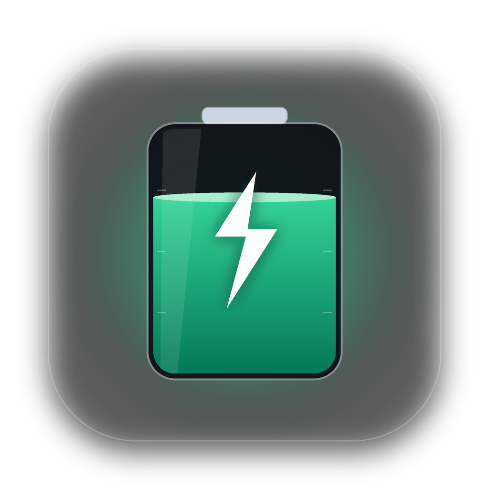
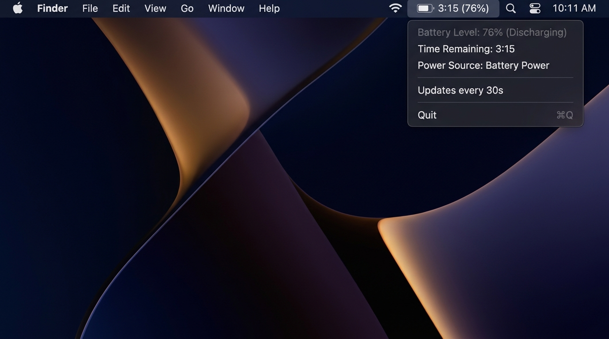

<div align="center">



# BatteryBar para macOS

**Widget nativo ultraligero y eficiente para la barra de menús de macOS que muestra el tiempo restante de batería y telemetría de hardware.**

🌐 [English](./README.md) | [Русский](./README.ru.md) | [Français](./README.fr.md) | **Español** | [简体中文](./README.zh.md)

<br/>

[](https://www.rust-lang.org/)
[](https://apple.com)
[](https://github.com/culcat/BatteryBar-MacOS/actions/workflows/build-dmg.yml)
[](/)
[](/)
[](LICENSE)

<br/>
<br/>



<br/>
<br/>

</div>

---

## ✨ Características principales

- **🚀 100 % Nativo**: Escrito en Rust puro con enlaces directos a Apple AppKit / Cocoa (`objc2`). Sin Electron, Tauri ni WebView.
- **🍃 Ultraligero**:
  - Tamaño del binario: solo **~2 MB**.
  - Uso de memoria RAM: **~10 MB**.
- **🔋 Cero consumo de batería**: Consulta el estado del sistema cada 30 segundos. Duerme el 99,98 % del tiempo con un **Impacto energético** de `0.0`.
- **🕶 Barra de menús limpia**: Se ejecuta en modo `Accessory` — no ocupa espacio en el Dock ni en el selector `Cmd + Tab`.
- **🌍 Soporte multiidioma (i18n)**: Detecta automáticamente el idioma del sistema macOS (**inglés, ruso, francés, español, chino**) y permite cambiar de idioma en vivo desde el menú.
- **🎨 Diseño nativo macOS Sonoma / Sequoia**:
  - **Iconos Apple SF Symbols**: Iconos vectoriales monocromáticos adaptativos (`battery.100percent`, `battery.100percent.bolt`, `powerplug.fill`, etc.) que se ajustan automáticamente al modo Claro y Oscuro.
  - **Tarjeta estilo Centro de Control**: `NSView` nativo personalizado en la cabecera del menú con barra de progreso en cápsula (`NSBezierPath`) que cambia dinámicamente de color (verde / naranja / rojo) y tipografía San Francisco (`monospacedDigitSystemFont`).
  - **Telemetría de hardware (`ioreg`)**: Muestra la **Salud de la batería** (`%` y `mAh`), los **Ciclos de carga** y el **Consumo / Potencia de carga** en tiempo real (vatios y voltios).
  - **Modos de visualización flexibles**: Cambia el formato al instante desde `Visualización en barra` (`3h 15m · 76%`, `3:15 · 76%`, `3h 15m` o `76%`).
- **🔄 Actualización manual (`⌘R`) y Ajustes (`⌘,`)**: Actualiza los datos al instante o abre directamente los Ajustes de Batería de macOS.
- **✨ Actualizador integrado (`⌘U`)**: Comprobación automática y manual de nuevas versiones en GitHub Releases.

---

## ⚡ Impacto en la batería

Muchas utilidades de monitoreo consumen batería al consultar los sensores cada segundo. **BatteryBar** está diseñado para no tener ningún impacto:

| Parámetro | Valor | Descripción |
| :--- | :--- | :--- |
| **Intervalo de consulta** | `30 seg` | Mantiene estimaciones precisas sin despertar innecesariamente la CPU |
| **Tiempo de ejecución de `pmset`** | `~2–4 ms` | Usa solo $\approx 0,36$ segundos de CPU por hora |
| **Estado de reposo** | `Idle / Sleep` | Duerme de forma nativa dentro del RunLoop de macOS |
| **Energy Impact** | `0.0` | Cero impacto medible en la autonomía |

---

## 📦 Requisitos

- macOS 11.0 (Big Sur) o superior (Apple Silicon M1/M2/M3/M4 o Intel x86_64)
- [Rust & Cargo](https://rustup.rs/) (1.75+ para compilar desde el código fuente)

---

## 🚀 Instalación y uso

### Opción 1: Instalar mediante .DMG (Recomendado)
Descarga el instalador `.dmg` desde la sección [Releases](https://github.com/culcat/BatteryBar-MacOS/releases) o constrúyelo localmente:
```bash
./scripts/build_dmg.sh
```
Abre el archivo `BatteryBar-0.2.0.dmg` generado y arrastra **BatteryBar** a la carpeta **Applications**.

### Opción 2: Compilar desde el código fuente
```bash
git clone https://github.com/culcat/BatteryBar-MacOS.git
cd BatteryBar-MacOS
cargo build --release
./target/release/battery-bar &
```

---

## ⚙️ Inicio automático al iniciar sesión (LaunchAgent)

Para que **BatteryBar** se inicie automáticamente al encender tu Mac:

1. Copia el binario compilado en `~/.local/bin`:
   ```bash
   mkdir -p ~/.local/bin
   cp ./target/release/battery-bar ~/.local/bin/
   ```

2. Crea el archivo `~/Library/LaunchAgents/com.culcat.batterybar.plist`:
   ```xml
   <?xml version="1.0" encoding="UTF-8"?>
   <!DOCTYPE plist PUBLIC "-//Apple//DTD PLIST 1.0//EN" "http://www.apple.com/DTDs/PropertyList-1.0.dtd">
   <plist version="1.0">
   <dict>
       <key>Label</key>
       <string>com.culcat.batterybar</string>
       <key>ProgramArguments</key>
       <array>
           <string>/Users/YOUR_USERNAME/.local/bin/battery-bar</string>
       </array>
       <key>RunAtLoad</key>
       <true/>
       <key>KeepAlive</key>
       <true/>
       <key>ProcessType</key>
       <string>Interactive</string>
   </dict>
   </plist>
   ```

3. Activa el agente:
   ```bash
   launchctl load ~/Library/LaunchAgents/com.culcat.batterybar.plist
   ```

*(Para detenerlo: `launchctl unload ~/Library/LaunchAgents/com.culcat.batterybar.plist`)*

---

## 🛠 Personalización

El intervalo de actualización se configura en [`src/main.rs`](./src/main.rs):

```rust
const UPDATE_INTERVAL_SECS: u64 = 30; // Intervalo en segundos
```

El formato del texto y el análisis de telemetría se encuentran en [`src/battery.rs`](./src/battery.rs), y las traducciones en [`src/i18n.rs`](./src/i18n.rs).

---

## 🧪 Pruebas

Ejecuta las pruebas unitarias:
```bash
cargo test
```

---

## 📄 Licencia

MIT License © 2026 [culcat](https://github.com/culcat)
