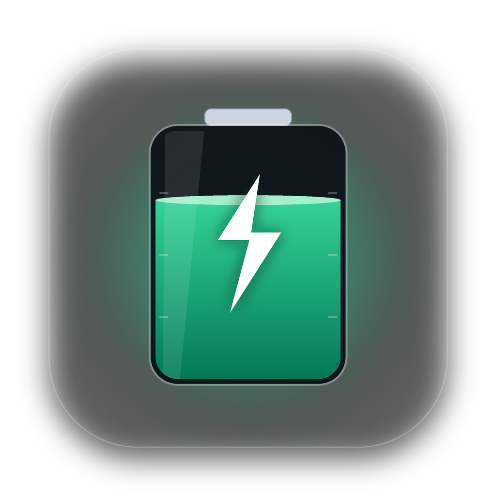
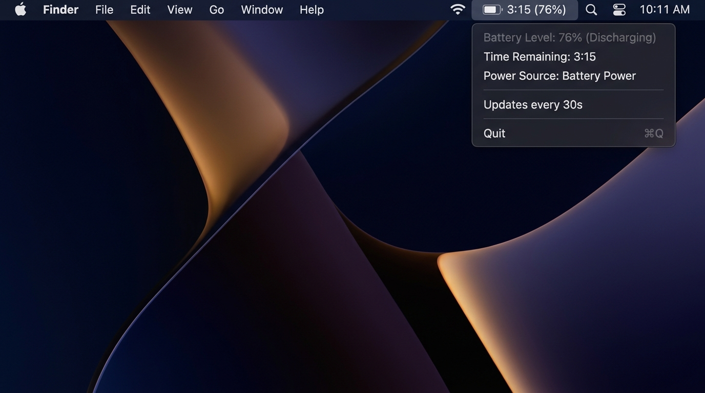

<div align="center">



# BatteryBar pour macOS

**Widget natif ultra-léger et économe en énergie pour la barre des menus macOS affichant l'autonomie restante et la télémétrie de la batterie.**

🌐 [English](./README.md) | [Русский](./README.ru.md) | **Français** | [Español](./README.es.md) | [简体中文](./README.zh.md)

<br/>

[](https://www.rust-lang.org/)
[](https://apple.com)
[](https://github.com/culcat/BatteryBar-MacOS/actions/workflows/build-dmg.yml)
[](/)
[](/)
[](LICENSE)

<br/>
<br/>



<br/>
<br/>

</div>

---

## ✨ Points forts

- **🚀 100 % Natif** : Écrit en Rust pur avec des appels directs à Apple AppKit / Cocoa (`objc2`). Aucun Electron, Tauri ou WebView.
- **🍃 Ultra-léger** :
  - Taille du binaire : seulement **~2 Mo**.
  - Mémoire vive (RAM) : **~10 Mo**.
- **🔋 Aucun impact sur l'autonomie** : Interroge l'état du système toutes les 30 secondes. L'application dort 99,98 % du temps avec un **Impact énergétique** de `0.0`.
- **🕶 Barre des menus épurée** : Fonctionne en mode `Accessory` — n'encombre jamais le Dock ni le sélecteur `Cmd + Tab`.
- **🌍 Multilingue (i18n)** : Détecte automatiquement la langue du système macOS (**anglais, russe, français, espagnol, chinois**) et permet de changer de langue directement depuis le menu.
- **🎨 Design natif macOS Sonoma / Sequoia** :
  - **Icônes Apple SF Symbols** : Icônes vectorielles monochromes adaptatives (`battery.100percent`, `battery.100percent.bolt`, `powerplug.fill`, etc.) s'adaptant automatiquement aux modes Clair et Sombre.
  - **Carte façon Centre de contrôle** : `NSView` natif personnalisé en haut du menu avec une barre de progression en capsule (`NSBezierPath`) changeant de couleur (vert / orange / rouge) et la police San Francisco (`monospacedDigitSystemFont`).
  - **Télémétrie matérielle (`ioreg`)** : Affiche la **Santé de la batterie** (`%` et `mAh`), le **Nombre de cycles** et la **Consommation / Puissance de charge** en temps réel (Watts et Volts).
  - **Modes d'affichage flexibles** : Changez de format à la volée via `Affichage barre des menus` (`3h 15m · 76%`, `3:15 · 76%`, `3h 15m` ou `76%`).
- **🔄 Actualisation immédiate (`⌘R`) & Réglages (`⌘,`)** : Actualisez l'état instantanément ou ouvrez directement les Réglages Système de batterie macOS.
- **✨ Mises à jour intégrées (`⌘U`)** : Vérification automatique et manuelle des nouvelles versions sur GitHub Releases.

---

## ⚡ Impact énergétique

Contrairement à de nombreux utilitaires qui sollicitent les capteurs chaque seconde, **BatteryBar** est conçu pour ne consommer aucune énergie :

| Paramètre | Valeur | Description |
| :--- | :--- | :--- |
| **Intervalle de lecture** | `30 s` | Précis sans réveiller inutilement les cœurs du processeur |
| **Temps d'exécution `pmset`** | `~2–4 ms` | Utilise seulement $\approx 0,36$ seconde de CPU par heure |
| **État de veille** | `Idle / Sleep` | Dort nativement dans la boucle d'événements Cocoa de macOS |
| **Energy Impact** | `0.0` | Aucun impact mesurable sur l'autonomie de la batterie |

---

## 📦 Prérequis

- macOS 11.0 (Big Sur) ou ultérieur (Apple Silicon M1/M2/M3/M4 ou Intel x86_64)
- [Rust & Cargo](https://rustup.rs/) (1.75+ pour compiler depuis les sources)

---

## 🚀 Installation et lancement

### Option 1 : Installation via .DMG (Recommandé)
Téléchargez l'installateur `.dmg` depuis la page [Releases](https://github.com/culcat/BatteryBar-MacOS/releases) ou générez-le localement :
```bash
./scripts/build_dmg.sh
```
Ouvrez le fichier `BatteryBar-0.2.0.dmg` généré et faites glisser **BatteryBar** dans le dossier **Applications**.

### Option 2 : Compilation depuis les sources
```bash
git clone https://github.com/culcat/BatteryBar-MacOS.git
cd BatteryBar-MacOS
cargo build --release
./target/release/battery-bar &
```

---

## ⚙️ Lancement automatique au démarrage (LaunchAgent)

Pour démarrer **BatteryBar** automatiquement à l'ouverture de session :

1. Copiez le binaire compilé dans `~/.local/bin` :
   ```bash
   mkdir -p ~/.local/bin
   cp ./target/release/battery-bar ~/.local/bin/
   ```

2. Créez le fichier `~/Library/LaunchAgents/com.culcat.batterybar.plist` :
   ```xml
   <?xml version="1.0" encoding="UTF-8"?>
   <!DOCTYPE plist PUBLIC "-//Apple//DTD PLIST 1.0//EN" "http://www.apple.com/DTDs/PropertyList-1.0.dtd">
   <plist version="1.0">
   <dict>
       <key>Label</key>
       <string>com.culcat.batterybar</string>
       <key>ProgramArguments</key>
       <array>
           <string>/Users/YOUR_USERNAME/.local/bin/battery-bar</string>
       </array>
       <key>RunAtLoad</key>
       <true/>
       <key>KeepAlive</key>
       <true/>
       <key>ProcessType</key>
       <string>Interactive</string>
   </dict>
   </plist>
   ```

3. Activez l'agent :
   ```bash
   launchctl load ~/Library/LaunchAgents/com.culcat.batterybar.plist
   ```

*(Pour arrêter : `launchctl unload ~/Library/LaunchAgents/com.culcat.batterybar.plist`)*

---

## 🛠 Personnalisation

L'intervalle de mise à jour est configurable dans [`src/main.rs`](./src/main.rs) :

```rust
const UPDATE_INTERVAL_SECS: u64 = 30; // Intervalle en secondes
```

Le formatage et l'analyse de télémétrie se trouvent dans [`src/battery.rs`](./src/battery.rs), et les traductions dans [`src/i18n.rs`](./src/i18n.rs).

---

## 🧪 Tests

Exécutez les tests unitaires :
```bash
cargo test
```

---

## 📄 Licence

MIT License © 2026 [culcat](https://github.com/culcat)
