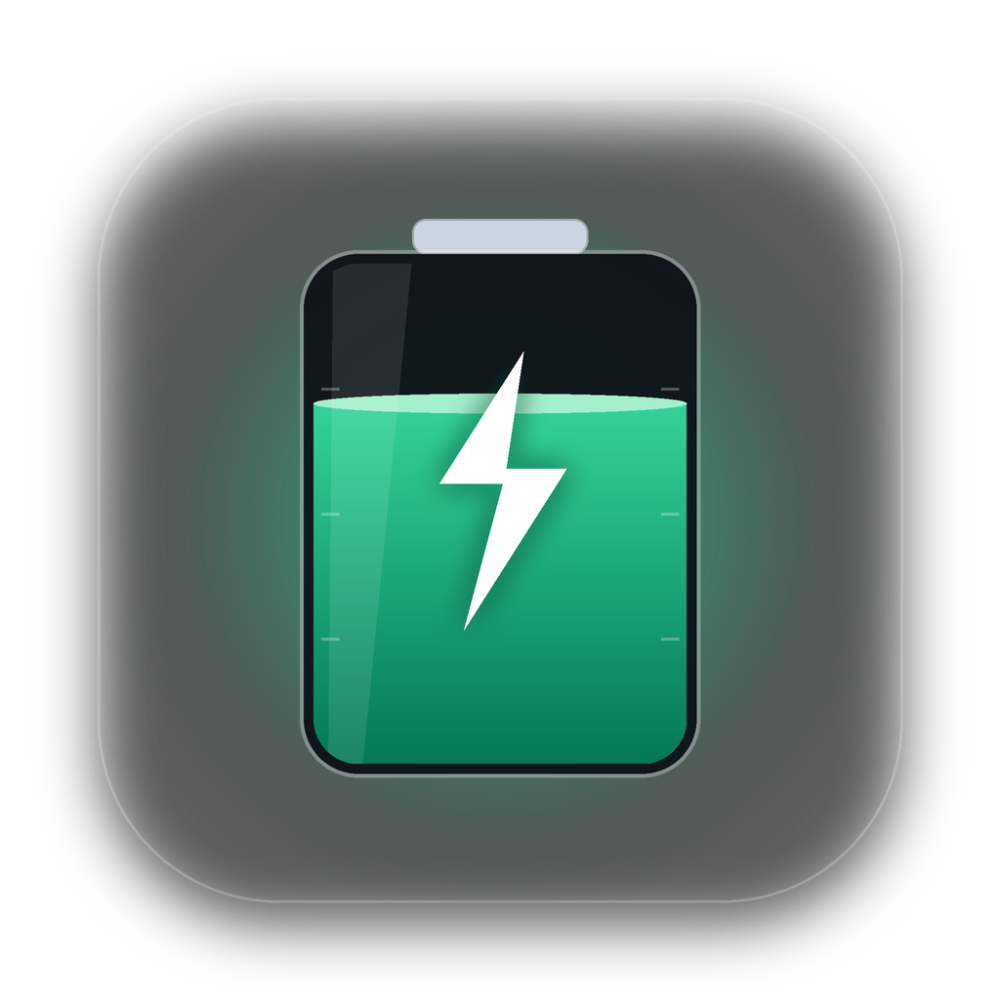
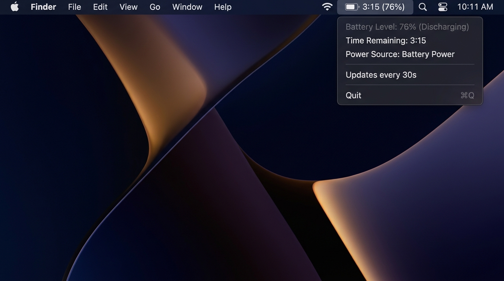

<div align="center">



# BatteryBar for macOS

**Ultra-lightweight, energy-efficient native macOS Menu Bar widget displaying battery time remaining and hardware telemetry.**

🌐 **English** | [Русский](./README.ru.md) | [Français](./README.fr.md) | [Español](./README.es.md) | [简体中文](./README.zh.md)

<br/>

[](https://www.rust-lang.org/)
[](https://apple.com)
[](https://github.com/culcat/homebrew-tap)
[](https://github.com/culcat/BatteryBar-MacOS/actions/workflows/build-dmg.yml)
[](/)
[](/)
[](LICENSE)

<br/>
<br/>



<br/>
<br/>

</div>

---

## ✨ Key Features

- **🚀 Truly Native**: Written in pure Rust with direct Apple AppKit / Cocoa bindings (`objc2`). Zero Electron, Tauri, or WebView bloat.
- **🍃 Ultra-Lightweight**:
  - Binary size: only **~2 MB**.
  - RAM footprint: **~10 MB**.
- **🔋 Zero Battery Drain**: Polls system status once every 30 seconds. Sleeps 99.98% of the time with an Activity Monitor **Energy Impact** of `0.0`.
- **🕶 Clean Menu Bar**: Runs in `Accessory` mode — never clutters your Dock or `Cmd + Tab` app switcher.
- **🌍 Multi-Language Support (i18n)**: Automatically detects your macOS system language (**English, Russian, French, Spanish, Chinese**) and allows live language switching directly from the menu.
- **🎨 Native macOS Sonoma / Sequoia Design**:
  - **Apple SF Symbols**: Adaptive monochrome vector icons (`battery.100percent`, `battery.100percent.bolt`, `powerplug.fill`, etc.) that automatically adapt to Light and Dark Mode wallpapers.
  - **Control Center Header Card**: Custom native `NSView` at the top of the menu with a smooth capsule progress bar (`NSBezierPath`) that transitions dynamically between green, orange, and red, paired with San Francisco `monospacedDigitSystemFont`.
  - **Hardware Telemetry (`ioreg`)**: Displays **Battery Health** (`%` and `mAh`), **Cycle Count**, and real-time **Power Draw / Charging Rate** (Watts & Volts).
  - **Flexible Display Modes**: Switch formats on the fly via `Menu Bar Display` (`3h 15m · 76%`, `3:15 · 76%`, `3h 15m`, or `76%`).
- **🔄 Instant Refresh (`⌘R`) & Battery Settings (`⌘,`)**: Refresh telemetry immediately or jump straight to macOS System Settings → Battery.
- **✨ Built-in Updater (`⌘U`)**: Automatic and manual GitHub Releases update checker.

---

## ⚡ Energy Impact

Many battery utilities ironically drain the battery by polling hardware sensors every second. **BatteryBar** is engineered to have zero impact:

| Metric | Value | Description |
| :--- | :--- | :--- |
| **Polling Interval** | `30 sec` | Keeps estimates accurate without waking CPU cores out of deep sleep |
| **`pmset` Execution Time** | `~2–4 ms` | Uses only $\approx 0.36$ seconds of CPU time per hour |
| **Idle State** | `Idle / Sleep` | Sleeps natively inside the macOS Cocoa RunLoop |
| **Energy Impact** | `0.0` | Zero measurable impact on battery runtime |

---

## 📦 Requirements

- macOS 11.0 (Big Sur) or later (Apple Silicon M1/M2/M3/M4 or Intel x86_64)
- [Rust & Cargo](https://rustup.rs/) (1.75+ if building from source)

---

## 🚀 Installation & Usage

### Option 1: Install via Homebrew (Recommended)
Install the prebuilt native `.app` bundle directly into `/Applications` using the official [Homebrew Tap](https://github.com/culcat/homebrew-tap):
```bash
brew tap culcat/tap
brew install --cask battery-bar
```
Or in a single command:
```bash
brew install --cask culcat/tap/battery-bar
```
*(Alternatively, you can install via Formula and run it as a background service: `brew install culcat/tap/battery-bar && brew services start battery-bar`)*

### Option 2: Install via .DMG
Download the latest `.dmg` installer from [Releases](https://github.com/culcat/BatteryBar-MacOS/releases) or build it locally:
```bash
./scripts/build_dmg.sh
```
Open the generated `BatteryBar-0.2.0.dmg` and drag **BatteryBar** into your **Applications** folder.

### Option 3: Build from Source
```bash
git clone https://github.com/culcat/BatteryBar-MacOS.git
cd BatteryBar-MacOS
cargo build --release
./target/release/battery-bar &
```

---

## ⚙️ Launch at Login (LaunchAgent)

To start **BatteryBar** automatically when you log in to macOS:

1. Copy the compiled binary to `~/.local/bin`:
   ```bash
   mkdir -p ~/.local/bin
   cp ./target/release/battery-bar ~/.local/bin/
   ```

2. Create `~/Library/LaunchAgents/com.culcat.batterybar.plist`:
   ```xml
   <?xml version="1.0" encoding="UTF-8"?>
   <!DOCTYPE plist PUBLIC "-//Apple//DTD PLIST 1.0//EN" "http://www.apple.com/DTDs/PropertyList-1.0.dtd">
   <plist version="1.0">
   <dict>
       <key>Label</key>
       <string>com.culcat.batterybar</string>
       <key>ProgramArguments</key>
       <array>
           <string>/Users/YOUR_USERNAME/.local/bin/battery-bar</string>
       </array>
       <key>RunAtLoad</key>
       <true/>
       <key>KeepAlive</key>
       <true/>
       <key>ProcessType</key>
       <string>Interactive</string>
   </dict>
   </plist>
   ```

3. Load the agent:
   ```bash
   launchctl load ~/Library/LaunchAgents/com.culcat.batterybar.plist
   ```

*(To stop: `launchctl unload ~/Library/LaunchAgents/com.culcat.batterybar.plist`)*

---

## 🛠 Customization

The polling interval can be configured in [`src/main.rs`](./src/main.rs):

```rust
const UPDATE_INTERVAL_SECS: u64 = 30; // Interval in seconds
```

Menu bar formatting and telemetry parsing are located in [`src/battery.rs`](./src/battery.rs), and translations are in [`src/i18n.rs`](./src/i18n.rs).

---

## 🧪 Testing

Run the unit test suite (covers `pmset` parsing, `ioreg` telemetry enrichment, semver comparison, and locale detection):
```bash
cargo test
```

---

## 📄 License

MIT License © 2026 [culcat](https://github.com/culcat)
