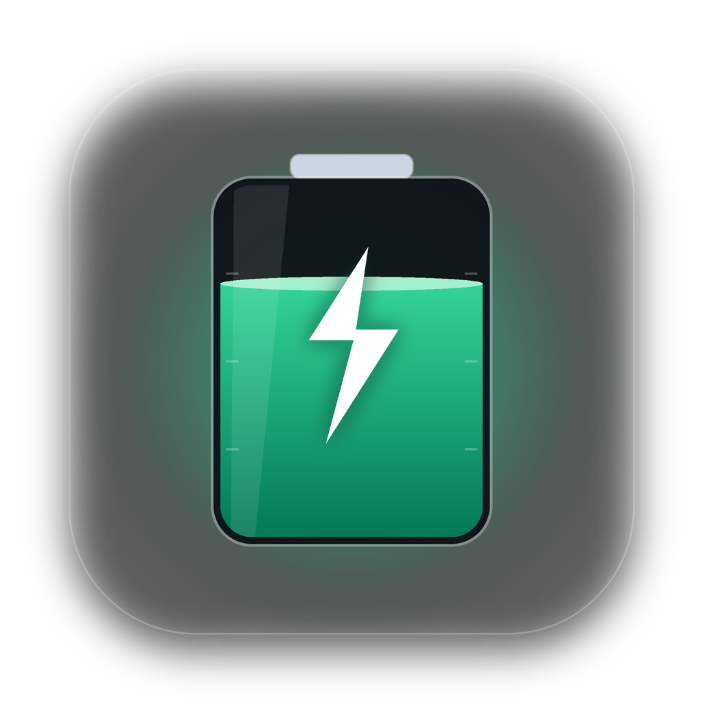
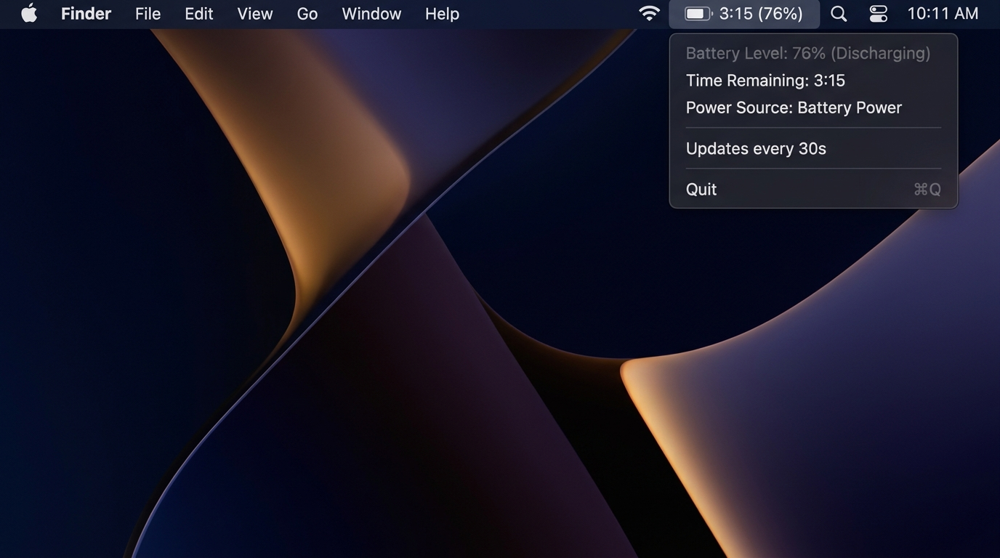

<div align="center">



# BatteryBar для macOS

**Легковесный и ультра-энергоэффективный нативный виджет оставшегося времени аккумулятора в строке меню macOS.**

🌐 [English](./README.md) | **Русский** | [Français](./README.fr.md) | [Español](./README.es.md) | [简体中文](./README.zh.md)

<br/>

[](https://www.rust-lang.org/)
[](https://apple.com)
[](https://github.com/culcat/BatteryBar-MacOS/actions/workflows/build-dmg.yml)
[](/)
[](/)
[](LICENSE)

<br/>
<br/>



<br/>
<br/>

</div>

---

## ✨ Преимущества

- **🚀 Настоящий Native**: Написан на чистом Rust с прямыми вызовами Apple AppKit / Cocoa (`objc2`). Никаких Electron, Tauri или WebView.
- **🍃 Ультра-легкий**:
  - Исполняемый файл: всего **~2 МБ**.
  - Потребление оперативной памяти: **~10 МБ**.
- **🔋 Не сажает батарею**: Опрос системного статуса выполняется раз в 30 секунд. 99.98% времени приложение спит в фоновом режиме, показатель **Energy Impact** равен `0.0`.
- **🕶 Чистый Menu Bar**: Работает в режиме `Accessory` — не захламляет Dock и панель переключения `Cmd + Tab`.
- **🌍 Мультиязычность (i18n)**: Автоматически определяет язык системы macOS (**английский, русский, французский, испанский, китайский**) и позволяет переключать язык на лету прямо из меню.
- **🎨 Эталонный дизайн macOS Sonoma / Sequoia**:
  - **Системные иконки SF Symbols**: Монохромные адаптивные векторные иконки (`battery.100percent`, `battery.100percent.bolt`, `powerplug.fill` и др.), автоматически подстраивающиеся под светлые и темные обои.
  - **Карточка Control Center**: Кастомный нативный `NSView` в шапке меню с капсульным индикатором заряда (`NSBezierPath`), плавно меняющим цвет (зеленый / оранжевый / красный), и системной типографикой San Francisco (`monospacedDigitSystemFont`).
  - **Расширенная телеметрия (`ioreg`)**: Отображение здоровья аккумулятора (`Здоровье батареи` в `%` и `мА·ч`), циклов перезарядки (`Количество циклов`) и текущей мощности (`Потребление / Мощность зарядки` в Ваттах и Вольтах).
  - **Гибкие режимы отображения**: Переключение формата прямо из подменю `Вид в строке меню` (`3ч 15м · 76%`, `3:15 · 76%`, `3ч 15м` или `76%`).
- **🔄 Ручное обновление (`⌘R`) и Настройки (`⌘,`)**: Мгновенное обновление статуса и быстрый переход в системные настройки батареи macOS.
- **✨ Проверка обновлений (`⌘U`)**: Встроенный апдейтер с автоматической и ручной проверкой новых релизов на GitHub.

---

## ⚡ Влияние на аккумулятор

Многие утилиты мониторинга сами расходуют заряд, непрерывно опрашивая датчики. В **BatteryBar** это исключено:

| Параметр | Значение | Описание |
| :--- | :--- | :--- |
| **Интервал опроса** | `30 сек` | Достаточно для актуальности, не будит ядра CPU слишком часто |
| **Время выполнения `pmset`** | `~2-4 мс` | За 1 час процессор тратит всего $\approx 0.36$ секунды |
| **Режим ожидания** | `Idle / Sleep` | Процесс засыпает в нативном RunLoop macOS |
| **Energy Impact** | `0.0` | Не влияет на автономность даже за сутки работы |

---

## 📦 Требования

- macOS 11.0 (Big Sur) или новее (Apple Silicon M1/M2/M3/M4 или Intel x86_64)
- [Rust & Cargo](https://rustup.rs/) (версии 1.75+ для сборки из исходников)

---

## 🚀 Установка и запуск

### Вариант 1. Установка через .DMG (Рекомендуется)
Скачайте готовый установщик `.dmg` из раздела [Releases](https://github.com/culcat/BatteryBar-MacOS/releases) или соберите его локально:
```bash
./scripts/build_dmg.sh
```
Откройте созданный файл `BatteryBar-0.2.0.dmg` и перетащите иконку **BatteryBar** в папку **Applications**.

### Вариант 2. Ручная сборка из исходников
```bash
git clone https://github.com/culcat/BatteryBar-MacOS.git
cd BatteryBar-MacOS
cargo build --release
./target/release/battery-bar &
```

---

## ⚙️ Автозапуск при входе в систему (LaunchAgent)

Чтобы приложение автоматически стартовало при включении Mac:

1. Скопируйте скомпилированный бинарник в удобную директорию (например, `~/.local/bin`):
   ```bash
   mkdir -p ~/.local/bin
   cp ./target/release/battery-bar ~/.local/bin/
   ```

2. Создайте файл конфигурации `~/Library/LaunchAgents/com.culcat.batterybar.plist`:
   ```xml
   <?xml version="1.0" encoding="UTF-8"?>
   <!DOCTYPE plist PUBLIC "-//Apple//DTD PLIST 1.0//EN" "http://www.apple.com/DTDs/PropertyList-1.0.dtd">
   <plist version="1.0">
   <dict>
       <key>Label</key>
       <string>com.culcat.batterybar</string>
       <key>ProgramArguments</key>
       <array>
           <string>/Users/YOUR_USERNAME/.local/bin/battery-bar</string>
       </array>
       <key>RunAtLoad</key>
       <true/>
       <key>KeepAlive</key>
       <true/>
       <key>ProcessType</key>
       <string>Interactive</string>
   </dict>
   </plist>
   ```

3. Активируйте агент:
   ```bash
   launchctl load ~/Library/LaunchAgents/com.culcat.batterybar.plist
   ```

*(Для остановки: `launchctl unload ~/Library/LaunchAgents/com.culcat.batterybar.plist`)*

---

## 🛠 Кастомизация

Интервал обновления настраивается в файле [`src/main.rs`](./src/main.rs):

```rust
const UPDATE_INTERVAL_SECS: u64 = 30; // Время в секундах
```

Форматирование выводимого текста находится в [`src/battery.rs`](./src/battery.rs), а словари локализации — в [`src/i18n.rs`](./src/i18n.rs).

---

## 🧪 Тестирование

Проект покрыт юнит-тестами (парсинг `pmset`, телеметрия `ioreg`, сравнение версий и определение системного языка):
```bash
cargo test
```

---

## 📄 Лицензия

MIT License © 2026 [culcat](https://github.com/culcat)
