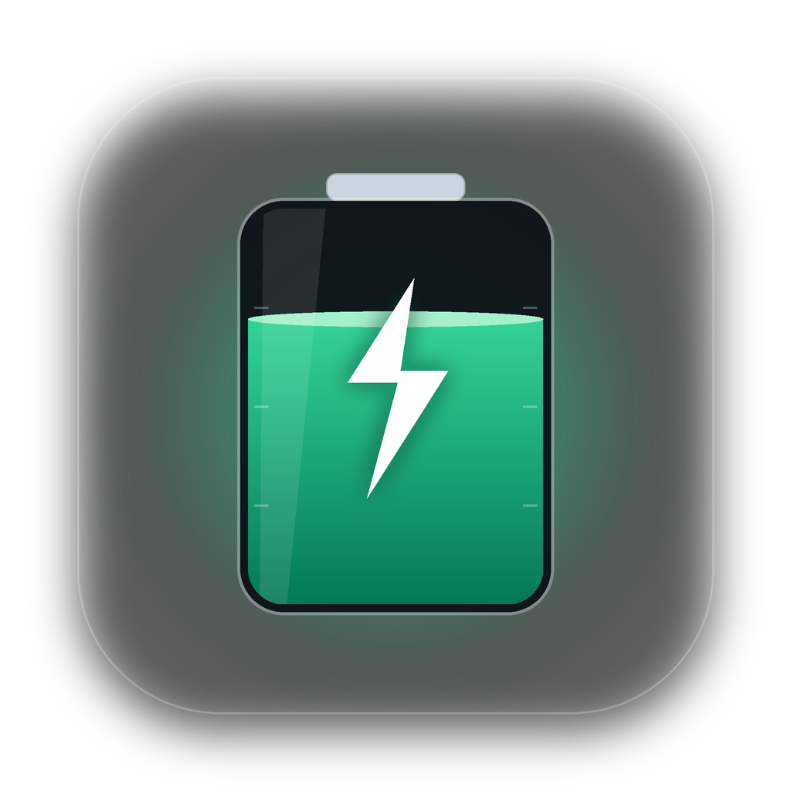
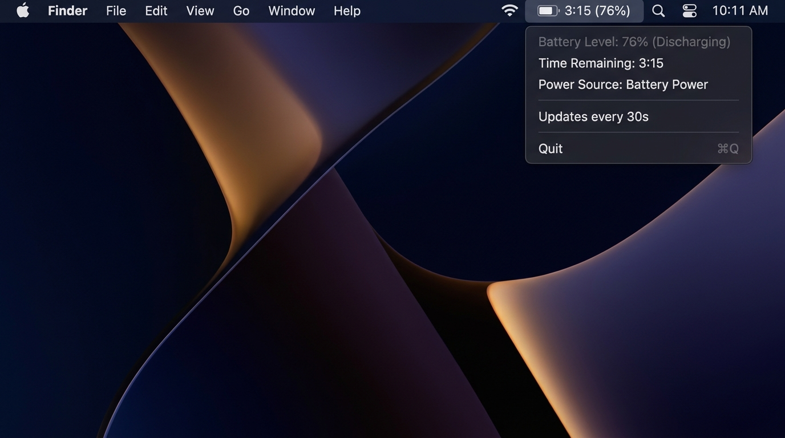

<div align="center">



# BatteryBar for macOS

**超轻量、极低功耗的 macOS 原生菜单栏电池剩余时间与硬件遥测小组件。**

🌐 [English](./README.md) | [Русский](./README.ru.md) | [Français](./README.fr.md) | [Español](./README.es.md) | **简体中文**

<br/>

[](https://www.rust-lang.org/)
[](https://apple.com)
[](https://github.com/culcat/homebrew-tap)
[](https://github.com/culcat/BatteryBar-MacOS/actions/workflows/build-dmg.yml)
[](/)
[](/)
[](LICENSE)

<br/>
<br/>



<br/>
<br/>

</div>

---

## ✨ 核心特性

- **🚀 纯正原生 (Truly Native)**：使用纯 Rust 编写，直接调用 Apple AppKit / Cocoa (`objc2`)，完全不依赖 Electron、Tauri 或 WebView。
- **🍃 超轻量级**：
  - 可执行文件体积：仅 **~2 MB**。
  - 内存占用：**~10 MB**。
- **🔋 零额外耗电**：每 30 秒轮询一次系统状态，99.98% 的时间处于深度休眠状态，活动监视器中的 **能耗影响 (Energy Impact)** 为 `0.0`。
- **🕶 纯净菜单栏体验**：以 `Accessory` 模式运行，不占用程序坞 (Dock) 和 `Cmd + Tab` 切换栏。
- **🌍 多语言国际化支持 (i18n)**：自动检测 macOS 系统语言（支持 **英语、俄语、法语、西班牙语、简体中文**），并支持在菜单中随时实时切换语言。
- **🎨 原生 macOS Sonoma / Sequoia 设计语言**：
  - **Apple SF Symbols 图标**：自适应单色矢量系统图标（`battery.100percent`、`battery.100percent.bolt`、`powerplug.fill` 等），自动适配浅色与深色模式壁纸。
  - **控制中心风格顶部卡片**：自定义原生 `NSView` 头部卡片，配备动态变色（绿 / 橙 / 红）胶囊进度条 (`NSBezierPath`) 与 San Francisco 等宽数字字体 (`monospacedDigitSystemFont`)。
  - **深度硬件遥测 (`ioreg`)**：展示 **电池健康度**（`%` 与 `mAh` 容量）、**循环次数** 以及实时 **当前功耗 / 充电功率**（瓦特与伏特）。
  - **灵活的菜单栏显示模式**：可在 `菜单栏显示格式` 子菜单中随时切换（`3h 15m · 76%`、`3:15 · 76%`、`3h 15m` 或 `76%`）。
- **🔄 立即刷新 (`⌘R`) 与 电池设置 (`⌘,`)**：支持手动立即刷新状态，或一键直达 macOS 系统“电池设置”。
- **✨ 内置更新检查 (`⌘U`)**：支持启动时自动检查与手动检查 GitHub Releases 最新版本。

---

## ⚡ 能耗表现

许多电池监控工具由于每秒频繁轮询硬件传感器，反而会消耗大量电量。**BatteryBar** 从架构层面消除了这一问题：

| 指标 | 数值 | 说明 |
| :--- | :--- | :--- |
| **轮询间隔** | `30 秒` | 兼顾数据实时性，避免频繁唤醒 Apple Silicon CPU 核心 |
| **`pmset` 执行耗时** | `~2–4 毫秒` | 每运行 1 小时累计仅消耗约 $\approx 0.36$ 秒 CPU 时间 |
| **空闲状态** | `Idle / Sleep` | 原生休眠于 macOS Cocoa RunLoop 事件循环中 |
| **能耗影响 (Energy Impact)** | `0.0` | 对续航时间没有任何可测量的影响 |

---

## 📦 系统要求

- macOS 11.0 (Big Sur) 或更高版本（支持 Apple Silicon M1/M2/M3/M4 及 Intel x86_64）
- [Rust & Cargo](https://rustup.rs/)（从源码构建需 1.75+）

---

## 🚀 安装与运行

### 方式一：通过 Homebrew 安装（推荐）
通过官方 [Homebrew Tap](https://github.com/culcat/homebrew-tap) 将原生 `BatteryBar.app` 直接安装至 `/Applications`：
```bash
brew tap culcat/tap
brew install --cask battery-bar
```
或者使用单行命令安装：
```bash
brew install --cask culcat/tap/battery-bar
```
*（也可通过 Formula 安装并作为后台服务启动：`brew install culcat/tap/battery-bar && brew services start battery-bar`）*

### 方式二：通过 .DMG 安装包安装
从 [Releases](https://github.com/culcat/BatteryBar-MacOS/releases) 页面下载最新的 `.dmg` 安装包，或在本地打包：
```bash
./scripts/build_dmg.sh
```
打开生成的 `BatteryBar-0.2.0.dmg`，将 **BatteryBar** 拖拽至 **Applications（应用程序）** 文件夹即可。

### 方式三：从源码编译运行
```bash
git clone https://github.com/culcat/BatteryBar-MacOS.git
cd BatteryBar-MacOS
cargo build --release
./target/release/battery-bar &
```

---

## ⚙️ 开机自动启动 (LaunchAgent)

若希望登录 macOS 时自动启动 **BatteryBar**：

1. 将编译好的二进制文件复制到 `~/.local/bin`：
   ```bash
   mkdir -p ~/.local/bin
   cp ./target/release/battery-bar ~/.local/bin/
   ```

2. 创建配置文件 `~/Library/LaunchAgents/com.culcat.batterybar.plist`：
   ```xml
   <?xml version="1.0" encoding="UTF-8"?>
   <!DOCTYPE plist PUBLIC "-//Apple//DTD PLIST 1.0//EN" "http://www.apple.com/DTDs/PropertyList-1.0.dtd">
   <plist version="1.0">
   <dict>
       <key>Label</key>
       <string>com.culcat.batterybar</string>
       <key>ProgramArguments</key>
       <array>
           <string>/Users/YOUR_USERNAME/.local/bin/battery-bar</string>
       </array>
       <key>RunAtLoad</key>
       <true/>
       <key>KeepAlive</key>
       <true/>
       <key>ProcessType</key>
       <string>Interactive</string>
   </dict>
   </plist>
   ```

3. 加载启动项：
   ```bash
   launchctl load ~/Library/LaunchAgents/com.culcat.batterybar.plist
   ```

*（停止服务：`launchctl unload ~/Library/LaunchAgents/com.culcat.batterybar.plist`）*

---

## 🛠 自定义配置

可在 [`src/main.rs`](./src/main.rs) 中修改更新轮询间隔：

```rust
const UPDATE_INTERVAL_SECS: u64 = 30; // 轮询间隔（秒）
```

状态栏文本格式化与遥测解析位于 [`src/battery.rs`](./src/battery.rs)，多语言翻译字典位于 [`src/i18n.rs`](./src/i18n.rs)。

---

## 🧪 单元测试

运行单元测试（包含 `pmset` 解析、`ioreg` 硬件数据提取、语义化版本比较及系统语言检测测试）：
```bash
cargo test
```

---

## 📄 开源协议

MIT License © 2026 [culcat](https://github.com/culcat)
